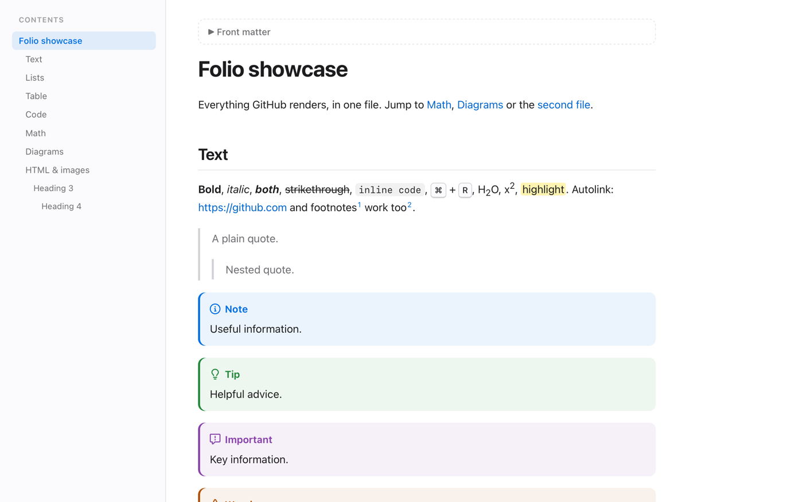
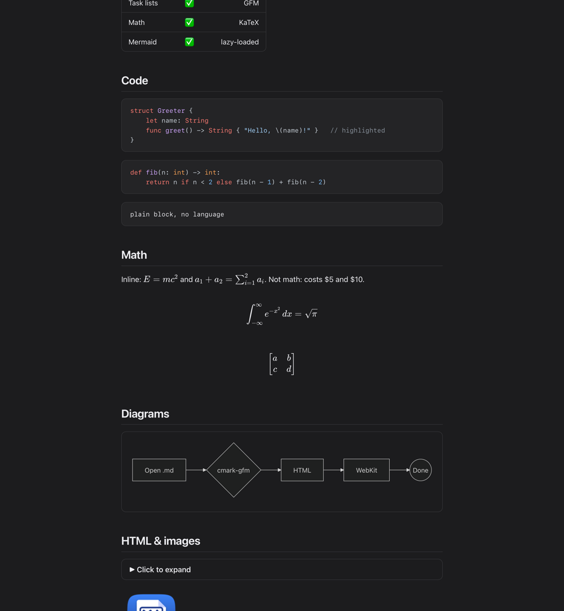

<p align="center"></p>

<h1 align="center">Folio</h1>

<p align="center">A small, fast, native Markdown viewer for Apple silicon Macs.</p>

<p align="center">
  <a href="https://github.com/biteasier/folio/releases/latest">Download</a> ·
  <a href="CHANGELOG.md">Changelog</a> ·
  <a href="SECURITY.md">Security</a>
</p>



## Features

- **Renders Markdown the way GitHub does**, using [cmark-gfm](https://github.com/github/cmark-gfm),
  GitHub's own parser: tables, task lists, strikethrough, autolinks, footnotes, raw HTML
  (`<details>`, `<kbd>`, `<sub>`, ``…) and alerts (`> [!NOTE]`, `TIP`, `IMPORTANT`,
  `WARNING`, `CAUTION`).
- **Code, math and diagrams:** syntax highlighting for about 40 languages, KaTeX math
  (`$inline$`, `$$display$$`, ```` ```math ````) and Mermaid diagrams (```` ```mermaid ````).
- **Live reload:** the page updates the moment you save the file in any editor, keeping your place.
- **Easy to read:** light and dark mode, a comfortable column width, a contents sidebar,
  find, zoom, and a Markdown source view.
- **Print and export to PDF.**
- **Links just work:** relative images load, links to other Markdown files open in Folio,
  `#anchors` scroll, and web links open in your browser.
- **Stays out of the way:** no Dock icon, just a small menu bar icon while it's open. Closing
  the last window quits it.
- Opens `.md`, `.markdown`, `.mdown`, `.mkd`, `.mkdn`, `.mdwn`, `.mdx`, `.rmd`, `.qmd` and plain text.



## Fast and light

- About a 2 MB download; the app itself is a 400 KB native arm64 binary.
- A document is on screen about half a second after launch.
- Parsing happens in C. Highlighting, math and diagram libraries load only when a document
  uses them, and code is coloured only as it scrolls into view.
- No Electron, no network access, no telemetry.

## Install

1. Download `Folio-<version>-arm64.zip` from [Releases](https://github.com/biteasier/folio/releases/latest)
   and unzip it.
2. Move **Folio** into **Applications**.
3. Folio isn't notarised by Apple, so the first time you open it macOS will block it.
   Open **System Settings → Privacy & Security**, scroll down, and click **Open Anyway** next
   to Folio. Or run this once in Terminal:

   ```bash
   xattr -dr com.apple.quarantine /Applications/Folio.app
   ```

To make Folio your default Markdown viewer: select any `.md` file in Finder, press ⌘I,
choose Folio under **Open with**, and click **Change All…**.

Requires macOS 12 or later on an Apple silicon Mac.

## Shortcuts

| Action | Keys |
|---|---|
| Open | ⌘O |
| Find / next / previous | ⌘F / ⌘G / ⇧⌘G |
| Contents sidebar | ⇧⌘T |
| Markdown source | ⌥⌘U |
| Reload | ⌘R |
| Zoom in / out / actual size | ⌘+ / ⌘− / ⌘0 |
| Export as PDF | ⌥⌘E |
| Print | ⌘P |
| Reveal in Finder | ⇧⌘R |

## Build from source

Needs Xcode 15 or later (or its Command Line Tools) on an Apple silicon Mac.

```bash
git clone https://github.com/biteasier/folio.git
cd folio
make build      # → build/Folio.app
make test       # parser unit tests
make run        # build and open the sample document
make install    # copy to /Applications
make release    # → dist/Folio-<version>-arm64.zip and its SHA-256
```

How it fits together:

- `Sources/FolioCore` turns Markdown into HTML (cmark-gfm, plus front matter and math).
- `Sources/Folio` is the app: documents, windows, live reload and the web view.
- `Resources/web` is the page: stylesheet, script and the bundled libraries.

For a headless render check, `--snapshot <in.md> <out.png>` renders a file to an image
(add `--dark`, `--toc` or `--source`, or write a PDF with `--pdf`). Launch it through `open`:

```bash
open -n -W --stdout /dev/stdout build/Folio.app --args --snapshot "$PWD/Samples/Showcase.md" "$PWD/build/showcase.png"
```

## Privacy and security

Folio never sends anything anywhere. Documents are treated as untrusted: they can't run
scripts or make network requests, apart from loading images. See [SECURITY.md](SECURITY.md).

## License

MIT, see [LICENSE](LICENSE). Folio bundles cmark-gfm, highlight.js, KaTeX and Mermaid under
their own licenses; see [NOTICE](NOTICE).
