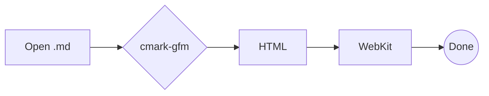

# Folio showcase

Everything GitHub renders, in one file. Jump to [Math](#math), [Diagrams](#diagrams) or the [second file](Other.md#hello).

## Text

**Bold**, *italic*, ***both***, ~~strikethrough~~, `inline code`, <kbd>⌘</kbd> + <kbd>R</kbd>, H<sub>2</sub>O, x<sup>2</sup>, <mark>highlight</mark>.
Autolink: https://github.com and footnotes[^1] work too[^note].

> A plain quote.
>
> > Nested quote.

> [!NOTE]
> Useful information.

> [!TIP]
> Helpful advice.

> [!IMPORTANT]
> Key information.

> [!WARNING]
> Needs attention.

> [!CAUTION]
> Risky action.

## Lists

1. First
2. Second
   - Nested bullet
   - Another
     1. Deep
3. Third

- [x] Done task
- [ ] Open task
- [ ] Another open task

## Table

| Feature | Supported | Notes |
|:--------|:---------:|------:|
| Tables | ✅ | aligned |
| Task lists | ✅ | GFM |
| Math | ✅ | KaTeX |
| Mermaid | ✅ | lazy-loaded |

## Code

```swift
struct Greeter {
    let name: String
    func greet() -> String { "Hello, \(name)!" }   // highlighted
}
```

```python
def fib(n: int) -> int:
    return n if n < 2 else fib(n - 1) + fib(n - 2)
```

```
plain block, no language
```

## Math

Inline: $E = mc^2$ and $a_1 + a_2 = \sum_{i=1}^{2} a_i$. Not math: costs $5 and $10.

$$
\int_{-\infty}^{\infty} e^{-x^2}\,dx = \sqrt{\pi}
$$

```math
\begin{bmatrix} a & b \\ c & d \end{bmatrix}
```

## Diagrams



## HTML & images

<details>
<summary>Click to expand</summary>

Hidden content with **Markdown** inside.

</details>


<p align="center"></p>

Definition-style HTML: <abbr title="HyperText Markup Language">HTML</abbr>.

---

### Heading 3
#### Heading 4
##### Heading 5
###### Heading 6

[^1]: A numbered footnote.
[^note]: A named footnote with `code`.
